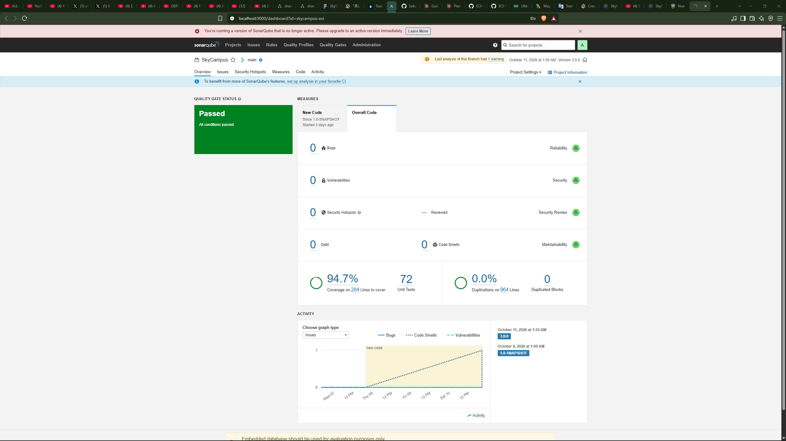

# Reto 13 Infernape - Quality Gate Enterprise (6 indicadores)

Regla de JaCoCo en `pom.xml` actualizada: línea ≥ 85%, rama ≥ 75% (Monferno exigía 80%/70%).

| # | Indicador | Objetivo | Resultado |
| --- | --- | --- | --- |
| 1 | Line coverage | ≥ 85% | 94.7% |
| 2 | Branch coverage | ≥ 75% | — (JaCoCo lo confirma en `verify`; Sonar Community no separa branch) |
| 3 | Bugs | 0 | 0 |
| 4 | Vulnerabilidades | 0 | 0 |
| 5 | Deuda técnica | < 15 min | 0 min |
| 6 | Duplicación | < 3% | 0.0% |

Los 6 están en verde.

## Issue encontrado y corregido

| Issue | Causa raíz | Corrección | Commit |
| --- | --- | --- | --- |
| `Convert the abstract class "FabricaDroneEtapa" into an interface` (CODE_SMELL, MINOR) | La clase abstracta no tenía estado ni campos; solo declaraba un método abstracto y cargaba, además, el método estático `paraPeso(...)` que no pertenece al contrato de fábrica. | Se convirtió `FabricaDroneEtapa` en interfaz pura. `paraPeso(...)` se movió a una clase nueva, `FabricasDroneEtapa`, dedicada solo a elegir la fábrica correcta. Las 3 fábricas concretas pasaron de `extends` a `implements`. | Este reto (feature/Granados-v3-quality-gate) |

No se suprimió ningún issue: se corrigió la causa raíz (la clase no necesitaba ser abstracta) y se verificó con las 72 pruebas existentes más un segundo análisis de SonarQube, que confirmó 0 issues abiertos.
